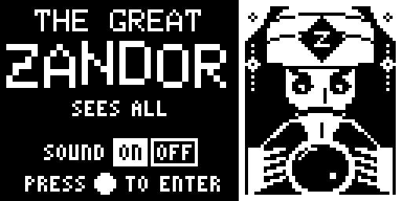
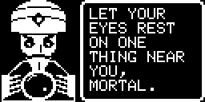
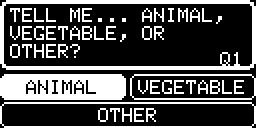
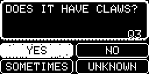
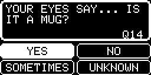
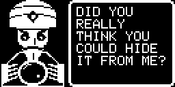

# The Great Zandor



Look around you. Pick one thing you can see. The Great Zandor will tell you what you are looking at in 21 questions... or fewer.

A 21 questions game hosted by a creepy fortune teller who sees through your eyes. He knows 1,100 things you might be
looking at, at home, at work, in a waiting room or down by the lake: animals, food, furniture, clothes, gadgets, tools, vehicles and more.

By **jaychugstein** · MIT License · Made for the **Arduboy FX and FX-C** (it uses the FX flash chip).
I made it with hopes of one day seeing it enjoyed on the **POOM** too.

**Play it in your browser:** https://jaychugstein.github.io/The-Great-Zandor/ (works on phones too)

 
 
 


## How to play

1. Look at something near you. It has to be a real thing you can see.
2. Tell Zandor what kind of thing it is: ANIMAL, PLANT, MAN-MADE or OTHER (OTHER is the rest of nature: a rock, sand, water, snow, a cloud).
3. Answer his questions: YES, NO, SOMETIMES or UNKNOWN.
4. He guesses along the way when the spirits are sure. If his guess at question 21 is wrong, he keeps going up to 25.
5. Win or lose, he then asks if you would like to hear your future. Say yes and he tells you a fortune for the next 24 hours
   (one of over 450), or now and then today's lucky or unlucky number. Say no and you are back at the booth.

One wrong answer won't throw him off.

## Controls

| Button | What it does |
|---|---|
| Arrows | Move the highlight between the four answer boxes |
| B | Choose the highlighted answer · move his speech along |
| A or B | Start (title screen) |
| Left / Right | Sound ON or OFF (title screen) · YES or NO (your future) |

## Install

Load `release/TheGreatZandor.arduboy` with any FX-aware uploader or cart builder (for example the Arduboy Cart
Builder, the Arduboy Web Flasher or the Arduboy-Python-Utilities). Or use the separate files:
`release/TheGreatZandor.hex` and `release/TheGreatZandor-fxdata.bin` (the FX data).

## Building from source

The sketch is in `TheGreatZandor/` and needs the **Arduboy2**, **ArduboyFX** and **ArduboyTones** libraries.

* **Arduino IDE:** open `TheGreatZandor/TheGreatZandor.ino`, pick an Arduboy FX board, compile, then upload
  `TheGreatZandor/fxdata/fxdata.bin` as the FX development data.
* **Command line:** `./build.sh` (set the library paths at the top) → `build/TheGreatZandor.hex`.

Everything Zandor knows comes from Python scripts in `art/`:

```
cd art
python3 zandor.py     # Zandor's portrait
python3 pack.py       # the questions, the things and the answer table -> TheGreatZandor/fxdata/ and fxdata.h
python3 sim.py        # optional: plays thousands of pretend games and reports how often he wins
```

`art/data.py`, `art/more.py`, `art/more2.py`, `art/more3.py` and `art/more4.py` hold the questions and the things he knows, with their answers.
`art/fortunes.py` holds his fortunes, and `TheGreatZandor/lines.h` everything else he says.
`art/fixes.py` holds plain-fact corrections (a basketball is a ball, the moon glows).
`art/learned.json` holds the answers real players gave in the training survey (they override the rest).
`art/fastsim.py` is a quicker copy of the simulator, and `art/mkqueue.py` builds the question list for the training survey.
`art/worst.py` and `art/audit.py` list the things he misses most.

## Browser version

`docs/` is a small web page that runs the real game files in the
[Ardens](https://github.com/tiberiusbrown/Ardens) emulator (MIT, by Peter Brown). It's served by GitHub
Pages from the `docs` folder.

## License

MIT — see [LICENSE](LICENSE). Uses the Arduboy2 (BSD 3-Clause), ArduboyFX (CC0) and ArduboyTones
(BSD 3-Clause) libraries.
